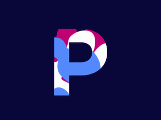
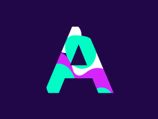
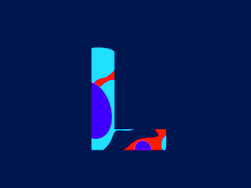
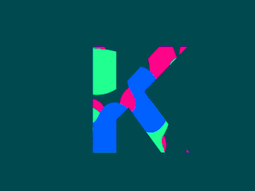
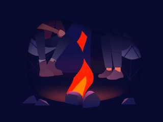
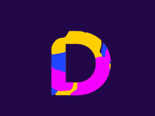
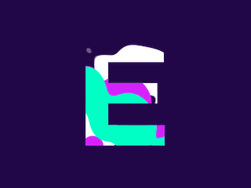
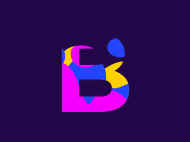
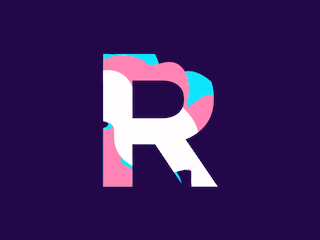

<!--
    
-->
<!--
    
-->

  

<!-- 

  

 -->

  <picture>
    <source media="(prefers-color-scheme: dark)" srcset="https://raw.githubusercontent.com/CaptainBlue793/CaptainBlue793/d16f959ebd01692e972ba77c5727c3d6e233cb22/Icons/tech/skills-dark.svg">
    <source media="(prefers-color-scheme: light)" srcset="https://raw.githubusercontent.com/CaptainBlue793/CaptainBlue793/d16f959ebd01692e972ba77c5727c3d6e233cb22/Icons/tech/skills-light.svg">
    
  </picture>
   
  

<!-- 

  

 -->

<!-- 

  
  
  

 -->

<!-- Original hosted wave footer, preserved for reuse:
  
-->
